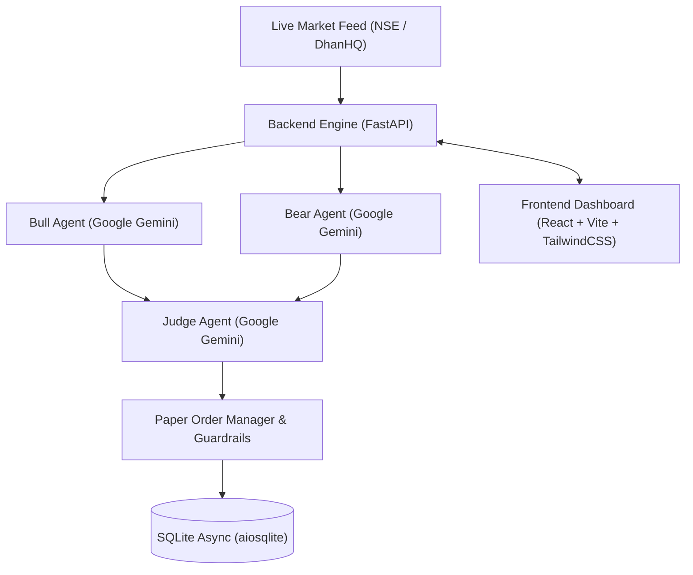

# NiftyDebateAI 🚀

An autonomous multi-agent debate platform and paper trading system designed for **Nifty 50** and **Bank Nifty** options trading on the National Stock Exchange of India (NSE).

NiftyDebateAI employs a adversarial AI framework where two specialized agents (**Bull Agent** and **Bear Agent**) analyze live multi-timeframe market structure, technical indicators, and option chain open interest, presenting competing arguments to an impartial **Judge Agent**. The Judge renders a verdict with strike selection, stop-loss, target, and risk-adjusted position sizing within strict capital guardrails.

---

## 🌟 Key Features

- **Adversarial Multi-Agent Debate Engine**:
  - **Bull Agent**: Identifies upside breakout structures, EMA support, momentum confirmations, and put writing / call unwinding.
  - **Bear Agent**: Identifies resistance rejection, overbought exhaustion, head-and-shoulders/breakdowns, and call writing.
  - **Judge Agent**: Evaluates debate evidence, verifies R:R ratio, filters out emotional biases, and dictates action: `BUY CE`, `BUY PE`, or `NO_TRADE`.
- **Live Real-Market Feeds**:
  - Live public exchange feed for real-time spot prices (Nifty 50 & Bank Nifty) and historical 15m OHLC candlesticks.
  - Seamless DhanHQ v2 REST integration supporting official quotes and option chain fallback cascade.
- **Strict Capital & Safety Guardrails**:
  - **1-Lot Enforcement**: Strictly caps all trades to exactly 1 lot (25 for Nifty 50, 15 for Bank Nifty).
  - **₹5,000 Capital Limit**: Hard-coded safety check rejecting any option position exceeding ₹5,000 premium.
  - **₹700 Maximum Stop-Loss**: Hard-coded safety cap restricting risk to $\le$ ₹700 per trade (28 pts on Nifty, 46.66 pts on Bank Nifty).
  - **₹1,000 Maximum Target**: Hard-coded target limit restricting profit to $\le$ ₹1,000 per trade (40 pts on Nifty, 66.66 pts on Bank Nifty).
- **Mobile-Responsive Full-Stack Dashboard**:
  - Fully responsive layout optimized for mobile smartphones, tablets, and desktop displays.
  - Dedicated Mobile Strike Card view for the Option Chain with CE/PE filters and 1-tap trade triggers.
  - Responsive TradingView Lightweight Chart with auto-scaling `ResizeObserver`.
  - Interactive multi-index switcher (Nifty 50 vs. Bank Nifty).
  - Real-time option chain with strike depths and Greeks/OI.
  - Live streaming multi-round debate view with transcripts.
  - Position summary, P&L monitor, and manual order entry modal.

---

## 🛠️ Architecture & Tech Stack



- **Backend**: Python 3.12, FastAPI, SQLAlchemy 2.0 (asyncio), aiosqlite, Google Generative AI SDK, httpx, APScheduler.
- **Frontend**: React 18, Vite, Tailwind CSS, Recharts, Lucide React.
- **Testing**: Pytest, Asyncio-Pytest, full mock integration test suite.

---

## 📋 Prerequisites

- **Python 3.10+** (Python 3.12 recommended)
- **Node.js 18+** & **npm**
- **Google Gemini API Key** (Get free key from [Google AI Studio](https://aistudio.google.com/))
- *(Optional)* DhanHQ Client ID and Access Token for direct broker feed integration.

---

## 🚀 Quick Start

### 1. Clone the Repository

```bash
git clone https://github.com/PravinG0/NiftyDebateAI.git
cd NiftyDebateAI
```

### 2. Backend Setup

```bash
cd backend

# Create and activate a Python virtual environment
python3 -m venv venv
source venv/bin/activate  # On Windows: venv\Scripts\activate

# Install dependencies
pip install -r requirements.txt

# Configure environment variables
cp ../.env.example ../.env
# Edit ../.env and paste your GEMINI_API_KEY
```

Start the backend API server:
```bash
uvicorn main:app --host 0.0.0.0 --port 8000 --reload
```
The FastAPI backend will be available at `http://localhost:8000`. Interactive Swagger documentation is at `http://localhost:8000/docs`.

### 3. Frontend Setup

In a new terminal window:

```bash
cd frontend

# Install npm dependencies
npm install

# Start Vite development server
npm run dev
```

The frontend dashboard will be live at `http://localhost:5173`.

---

## ⚙️ Environment Variables

Create a `.env` file in the project root:

```env
# Gemini AI Configuration
GEMINI_API_KEY=your_gemini_api_key_here
GEMINI_MODEL=gemini-2.5-flash

# Database Configuration
DATABASE_URL=sqlite+aiosqlite:///./niftydebate.db

# OpenAlgo / Paper Trading Configuration
OPENALGO_API_KEY=your_openalgo_api_key_here
OPENALGO_HOST=http://127.0.0.1:5000

# DhanHQ API Configuration (Optional)
DHAN_CLIENT_ID=your_dhan_client_id
DHAN_ACCESS_TOKEN=your_dhan_access_token
DHAN_BASE_URL=https://api.dhan.co/v2

# System Flags
FORCE_ANALYZER_MODE=true
```

---

## 🧪 Testing

Run backend tests using pytest:

```bash
pytest backend/tests/
```

To run the end-to-end Dhan & Multi-index verification test suite:

```bash
pytest backend/tests/test_e2e_dhan_enhancements.py -v
```

---

## 🛡️ Risk Disclaimer

This software is an experimental, educational, and research-focused simulation framework. It is strictly configured for paper trading and decision analysis. Options trading involves substantial risk of loss and is not suitable for every investor. The creators and contributors of this software are not SEBI-registered advisors and assume no responsibility for any financial decisions or losses incurred.
